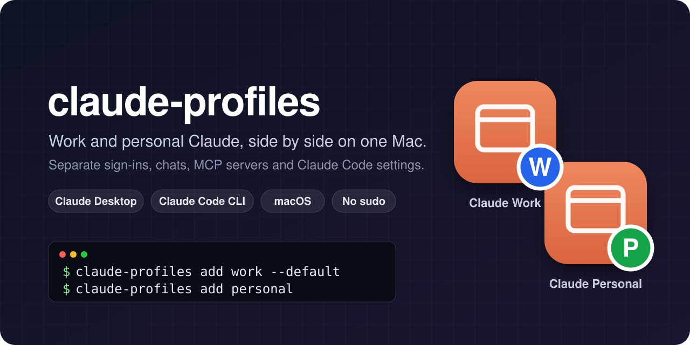
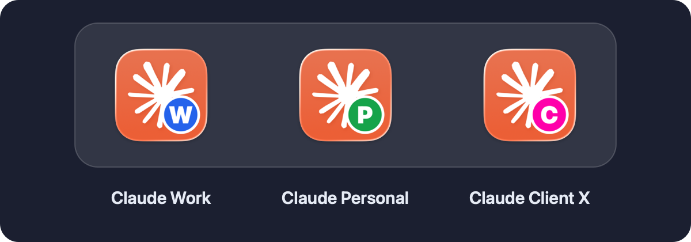
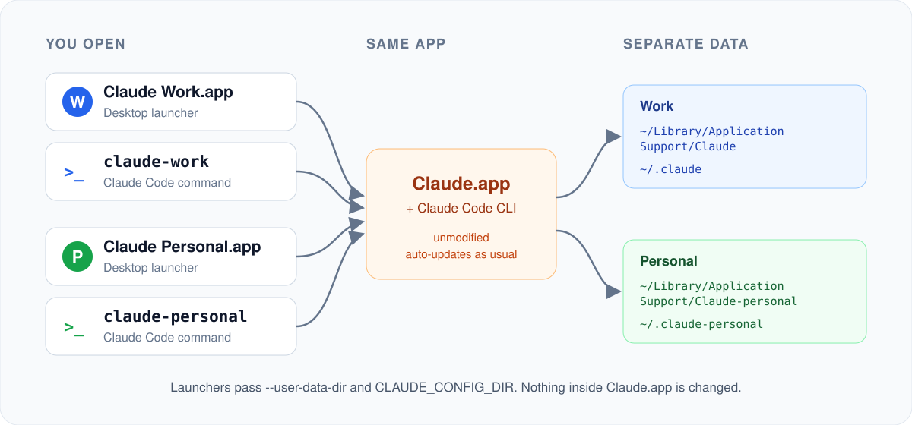

<div align="center">



# claude-profiles

**Run multiple Claude accounts side by side on one Mac.**<br>
Separate Claude Desktop apps and Claude Code CLI profiles for work, personal and clients, each with its own sign-in, chats, MCP servers and settings.

[](https://github.com/dav-ayman/claude-profiles/actions/workflows/ci.yml)
[](LICENSE)


[](CONTRIBUTING.md)

[Website](https://dav-ayman.github.io/claude-profiles/) · [Install](#install) · [Quick start](#quick-start) · [How it works](#how-it-works) · [FAQ](#faq) · [Contributing](CONTRIBUTING.md)

</div>

---

## Why

Claude Desktop is signed in to one account at a time. If you have a work account and a personal one, you end up signing out and back in, and your chats, connectors, MCP servers and Claude Code settings get mixed together.

**claude-profiles** gives every account its own app and its own `claude` command:

<p align="center">
  
</p>

- **Claude Work** and **Claude Personal** run at the same time, in separate windows.
- `claude-work` and `claude-personal` start Claude Code with the matching account and settings.
- Each profile keeps its own sign-in, chat history, MCP config, hooks, plugins and tracing.

## Features

- 🖥️ **Desktop and CLI in one tool.** One profile gives you a Desktop launcher *and* a Claude Code command.
- 🔐 **Fully separate profiles.** Each one has its own Desktop data folder and its own `CLAUDE_CONFIG_DIR`. Desktop's Code tab follows the profile too.
- 🏷️ **Badged icons.** Each launcher gets a colored letter badge drawn on your Mac from your own Claude icon. They look native on macOS 26 too.
- 🎯 **One window per profile.** Clicking a launcher again brings that profile to the front instead of opening a duplicate.
- 🔄 **Updates keep working.** Claude.app is never modified, re-signed or copied, so auto-updates go on as usual.
- 🧼 **Keeps your current setup.** `--default` turns your existing sign-in into a profile without moving anything.
- 🛡️ **Safe by design.** No sudo, no network at run time, never deletes files it didn't create, never runs profile files as code.
- 🍎 **Nothing to install.** Needs only what ships with macOS (bash 3.2, osascript, sips, codesign). Tested on macOS 14, 15 and 26, Apple Silicon and Intel.

## Install

With [Homebrew](https://brew.sh):

```sh
brew install dav-ayman/tap/claude-profiles
```

Or with the install script, which puts one file in `~/.local/bin` (no sudo):

```sh
curl -fsSL https://raw.githubusercontent.com/dav-ayman/claude-profiles/main/install.sh | bash
```

Prefer to read it first? See [`install.sh`](install.sh), or install from a clone:

```sh
git clone https://github.com/dav-ayman/claude-profiles
cd claude-profiles && make install
```

You'll need [Claude Desktop](https://claude.ai/download) and, for the CLI commands, [Claude Code](https://docs.anthropic.com/en/docs/claude-code).

## Quick start

```sh
claude-profiles add work --default   # your current Claude becomes "Claude Work"
claude-profiles add personal         # a second, fully separate profile
```

<p align="center">
  
</p>

Then:

1. Open **Claude Personal** from Spotlight, Launchpad or `~/Applications`, and sign in with your other account.
2. In a terminal, run `claude-personal` and type `/login` once.
3. Drag both launchers to your Dock.

That's it. `claude-profiles doctor` checks everything is wired correctly.

## Usage

| Command | What it does |
| --- | --- |
| `claude-profiles add <name>` | Create a profile: `~/Applications/Claude <Name>.app` and a `claude-<name>` command |
| `claude-profiles list` | Show profiles, their badges and the account each CLI profile is signed in to |
| `claude-profiles open <name>` | Start that profile's Desktop app, or bring it to the front |
| `claude-profiles refresh [name]` | Rebuild launchers, icons and commands (for example after moving Claude.app) |
| `claude-profiles remove <name>` | Delete the launcher and command. Data is kept unless you add `--purge --yes` |
| `claude-profiles doctor` | Check the setup and show which profile is running with which config |

Options for `add`:

| Option | Default | |
| --- | --- | --- |
| `--default` | | Use Claude's normal folders, so your existing sign-in stays. One profile only |
| `--label <text>` | `Name` | App name, shown as `Claude <label>` |
| `--letter <X>` | first letter | Badge letter |
| `--color <RRGGBB>` | from a palette | Badge color |
| `--data-dir <path>` | `~/Library/Application Support/Claude-<name>` | Desktop data folder |
| `--config-dir <path>` | `~/.claude-<name>` | Claude Code folder (`CLAUDE_CONFIG_DIR`) |
| `--no-desktop` / `--no-cli` | | Create only the CLI command, or only the Desktop app |

Examples:

```sh
claude-profiles add client-acme --label "Acme" --letter A --color DB2777
claude-profiles add personal --config-dir ~/.claude-personal   # reuse an existing Claude Code profile
claude-profiles add experiments --no-desktop                   # just a separate Claude Code profile
```

## How it works

<p align="center">
  
</p>

Claude Desktop is an Electron app. Electron keeps all its state in one data folder, and Claude Code keeps its own in `CLAUDE_CONFIG_DIR` (default `~/.claude`). claude-profiles points each profile at its own folders:

- **Desktop launcher**: a tiny signed applet in `~/Applications` that runs<br>
  `open -n -a Claude --env CLAUDE_CONFIG_DIR=<config> --args --user-data-dir=<data>`<br>
  If that profile is already running, it brings its window forward instead.
- **CLI command**: a 4-line script in `~/.local/bin` that sets `CLAUDE_CONFIG_DIR` and runs `claude`.
- **Profiles** are plain `key=value` files in `~/.config/claude-profiles/profiles/`.

`open` passes your terminal's environment through to the app, so the launchers clear any inherited `CLAUDE_CONFIG_DIR` first. A work window can't end up writing into the personal config, or the other way round.

## FAQ

<details>
<summary><b>Does this modify Claude Desktop?</b></summary>

No. Claude.app is never changed, copied or re-signed. The launchers just start it with different folders, which is also why auto-updates keep working.
</details>

<details>
<summary><b>Do updates still work?</b></summary>

Yes. All profiles share the one Claude.app, so a single update covers every profile. After an update, Claude reopens your default profile. Open the others again from their launchers.
</details>

<details>
<summary><b>Why does the Dock show "Claude" for every running window?</b></summary>

Running windows belong to the same Claude.app, so macOS shows its name and icon. Giving them their own would mean editing the app bundle, which breaks its signature and updates. The badged launchers are what you click; pin them to the Dock.
</details>

<details>
<summary><b>Can I keep my current Claude setup?</b></summary>

Yes. `claude-profiles add work --default` uses the folders Claude already uses, so nothing moves and you stay signed in. Only one profile can be the default.
</details>

<details>
<summary><b>I already use <code>CLAUDE_CONFIG_DIR</code> for Claude Code. Can I reuse it?</b></summary>

Yes: `claude-profiles add personal --config-dir ~/.claude-personal`. The CLI command and the Desktop Code tab will both use that folder.
</details>

<details>
<summary><b>Is it safe? What does it access?</b></summary>

It runs as you, without sudo, makes no network calls, and never reads your tokens. Each profile signs in by itself inside Claude. See [SECURITY.md](SECURITY.md).
</details>

<details>
<summary><b>Windows or Linux?</b></summary>

macOS only for now. The same idea works on Windows (`--user-data-dir` plus `CLAUDE_CONFIG_DIR`), and a contribution is very welcome. See [CONTRIBUTING.md](CONTRIBUTING.md).
</details>

## Troubleshooting

| Problem | Fix |
| --- | --- |
| `claude-personal: command not found` | Add `~/.local/bin` to your PATH: `echo 'export PATH="$HOME/.local/bin:$PATH"' >> ~/.zshrc` |
| A launcher shows a generic icon | Run `claude-profiles refresh`. If it persists, run `killall Dock` |
| Two windows of the same profile | Quit both and open the profile from its launcher only |
| Signing in to the second profile opens the wrong window | Quit the other profile while you sign in, then reopen it |
| Something else | Run `claude-profiles doctor` and [open an issue](https://github.com/dav-ayman/claude-profiles/issues/new/choose) with the output |

## Uninstall

```sh
claude-profiles remove personal     # repeat per profile; add --purge --yes to delete its data too
brew uninstall claude-profiles      # if installed with Homebrew, or:
curl -fsSL https://raw.githubusercontent.com/dav-ayman/claude-profiles/main/install.sh | bash -s -- --uninstall
```

## Contributing

Issues and pull requests are welcome. Start with [CONTRIBUTING.md](CONTRIBUTING.md). The test suite runs against a fake Claude.app, so it never touches your real setup:

```sh
brew install bats-core shellcheck
make lint test
```

If claude-profiles saves you some sign-in juggling, a ⭐ helps others find it.

## License

[MIT](LICENSE) © David Ayman

---

<sub>claude-profiles is an independent community project, not affiliated with or endorsed by Anthropic. Claude, Claude Desktop and Claude Code are trademarks of Anthropic, PBC. Launcher icons are drawn on your Mac from your own copy of Claude; the Claude icon in the screenshots is shown only to illustrate the result.</sub>
